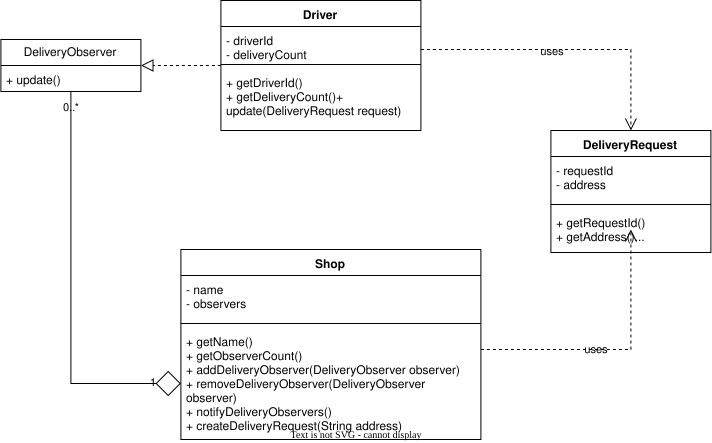

| CS-665       | Software Design & Patterns |
|--------------|----------------------------|
| Name         | Laya Dang                  |
| Date         | 10/20/2026                 |
| Course       | Fall 2026                  |
| Assignment # | 2                          |

# Assignment Overview

The goal of this assignment is to implement a delivery system between a store and its delivery drivers. This goal is executed by implementing the Observer pattern, with the store as the subject and the delivery drivers as the observer.

# GitHub Repository Link

https://github.com/pd03-cs-665/cs-665-assignment-2

# Implementation Description 

> Explain the level of flexibility in your implementation, including how new object types can be easily added or removed in the future.

The benefit of using the observer pattern (or for using most patterns) is the ability to abstract logic through different layers and classes. In this case, because the subject (store) only cares that the delivery driver has the method `update()`, the actual details on what the driver does upon receiving this request is abstracted away from the shop. Therefore, we have flexibility in the future if we wish to change what happens when the driver gets a delivery request, without having to change anything about the shop.

Futher, since `update()` is a strict requirement for the observer (delivery drivers), it is implemented as an abstract class and that class is referenced in the shop's implementation. This means that we will be able to add different types of observers to the shop in the future (ex. customer who wants to be notifed about their delivery) by extending that abstract class.

> Discuss the simplicity and understandability of your implementation, ensuring that it is easy for others to read and maintain.

This assignment uses the basic Observer pattern with the keywords associated with it (subject, observer, update method, etc.), so other developers will recognize immediately what pattern is used and understand the code structure.

The abstract and concrete class lives together in one package (`deliveryobserver/`), so it is clear when inheritance is used. Additionally, all variables in each class are private and has its own getter method to control access. The set of observers in the shop also has its own adder and remover method for data protection. Overall, these methods improve encapsulation so that it is easier to maintain.

> Describe how you have avoided duplicated code and why it is important.

The `createDeliveryRequest()` in the Shop object handles both the request creation and the notification(s) for the delivery observers through the `notifyDrivers()` helper method. This prevents duplication of having to repeatedly loop through the list of observer each time a delivery request is created. If we wish to change the behvaior of how delivery requests gets sent to observers, we will only need to update the helper method once.

> If applicable, mention any design patterns you have used and explain why they were chosen.

I chose the Observer pattern for this assignment, as the task involves one subject sending requests to many objects. The shop keeps track of what delivery observers are subscribed and calls the `update()` method when a request is created. This pattern aligns with the business logic of the shop creating the requests it receives and sending it out to drivers, but does not care about the details of what the driver does with the request. Because this de-coupling is an important aspect of the assignment, the observer pattern is the most appropriate.

# UML Diagram



# Maven Commands

We'll use Apache Maven to compile and run this project.

## Compile

```bash
mvn clean compile
```

## JUnit Tests

```bash
mvn clean test
```

## Spotbugs 

```bash
mvn spotbugs:gui 
```

## Checkstyle 

```bash
mvn checkstyle:checkstyle
```
